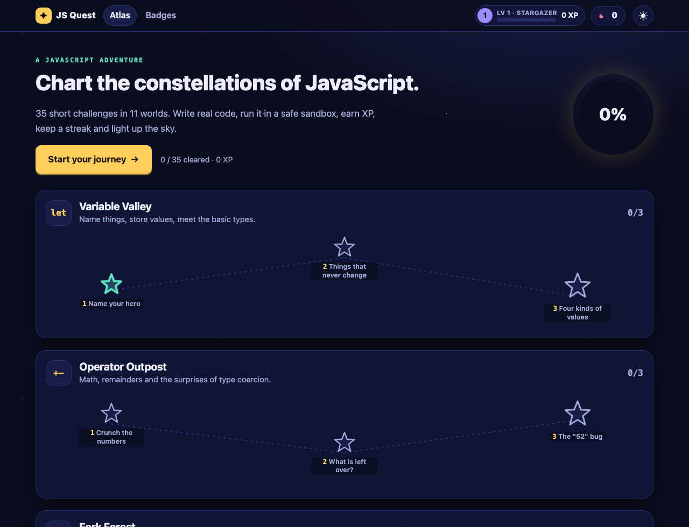
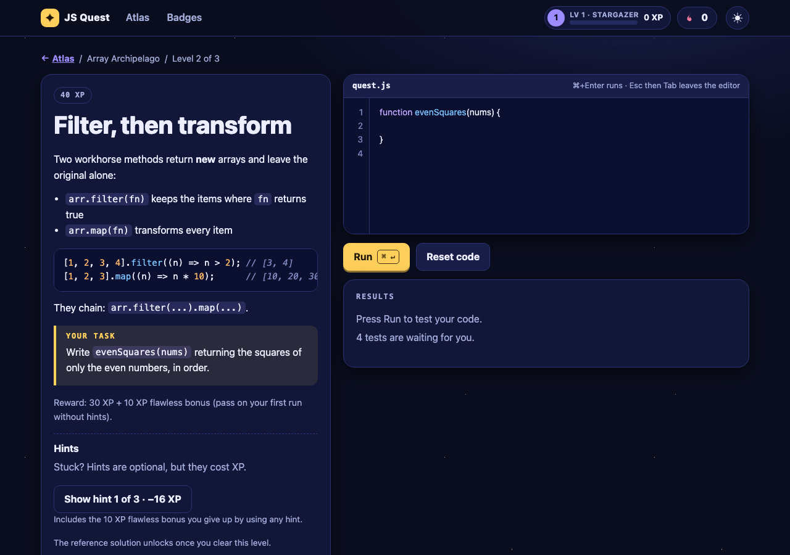

# JS Quest ✦

**Learn JavaScript by charting the stars.** JS Quest is an interactive, gamified platform for learning JavaScript. Pick a star on the atlas, read a short lesson, write real code in the editor, and hit **Run**. Your code executes in a sandbox and is checked against test cases that tell you exactly which ones pass or fail. Earn XP, level up, keep a daily streak, collect badges and light up all 11 constellations.

It is a static site — plain HTML, CSS and ES modules, **no backend, no build step, no runtime dependencies**. Everything runs in your browser and progress is saved in `localStorage`.





## Features

- **35 challenges in 11 worlds** — variables & types, operators, conditionals, loops, functions, arrays, objects, strings, scope & closures, async basics and DOM basics. Each world ends with a boss level.
- **Real code, real feedback** — a syntax-highlighted editor (auto-indent, Tab/Shift+Tab, native undo), a Run button (`⌘/Ctrl + Enter`), per-test pass/fail with *expected vs. got*, captured `console.log` output, and a page preview for DOM lessons.
- **Safe sandbox** — every run happens in a brand-new Web Worker that is killed after 4 seconds, so an accidental `while (true) {}` can never freeze the page.
- **Game layer** — XP and levels, a daily streak, 22 badges, hints that cost XP, a progress ring and a celebratory completion state with confetti.
- **Yours to keep** — progress and unsent drafts persist in `localStorage` (wrapped in `try/catch`; the app still works, with a notice, if storage is blocked).
- **Accessible** — fully keyboard operable (Esc then Tab leaves the editor), skip link, ARIA live regions for results, visible focus rings, `prefers-reduced-motion` respected, and light/dark themes that follow your system setting.
- **Strict CSP** — the page ships a Content-Security-Policy that only allows its own scripts and styles.

## Run it locally

You need [Node.js](https://nodejs.org) 20 or newer (only for the tiny dev server and the tests — the site itself needs nothing).

```bash
git clone https://github.com/0xmyst3ry/js_basics.git
cd js_basics
npm start
```

Then open <http://localhost:5173>. Any static file server works too (`python3 -m http.server`, `npx serve`, …). The site must be served over `http(s)://` because browsers don't allow module workers from `file://` URLs.

### Tests

```bash
npm test          # unit tests for the engine, mini DOM, runner, XP/progress and storage logic
npm run validate  # checks every challenge: schema, reference solution passes, starter fails
```

The suite uses Node's built-in test runner (`node:test`) — there is nothing to install. It also verifies that all 35 reference solutions pass their test cases and that a set of plausible-but-wrong answers (off-by-one loops, shared closure state, wrong `else if` order…) are rejected.

## How it works

```
index.html            page shell (CSP, theme bootstrap)
css/styles.css        "star chart" design system, dark + light themes
js/main.js            app state, hash router, wiring
js/ui/                rendering: map, challenge screen, editor, badges, dialogs
js/core/engine.js     runs learner code against a challenge's tests (works in Worker + Node)
js/core/worker.js     Web Worker entry point
js/core/runner.js     main-thread side: spawn worker, watchdog timer, terminate
js/core/minidom.js    tiny DOM (selectors, events, classList…) for the DOM lessons
js/core/progress.js   pure game logic: XP, levels, hints, streak, badges
js/core/storage.js    guarded localStorage + state sanitising
js/data/              the course: one file per world in challenges/, badges, catalog
tests/                node:test suites
```

**Sandbox model.** Learner code is compiled with `new Function` *inside a Web Worker*, which has no access to the page's DOM, cookies or `localStorage`. Network and messaging globals (`fetch`, `XMLHttpRequest`, `WebSocket`, `postMessage`, …) are shadowed, a fresh worker is created per run, and a watchdog terminates it after 4 s. This keeps the learner's own experiments from breaking the app; it is not designed to contain a determined attacker running their *own* code against *themselves*, and there is no shared state or account for them to target. The worker loads the challenge definitions itself, so test cases never pass through the page.

**Fresh state per test.** Each test case runs a fresh execution of the learner's code (new scope, console, timers and DOM), so tests can't contaminate each other.

**DOM lessons.** Workers have no DOM, so DOM Dojo uses a small built-in DOM (`js/core/minidom.js`). It supports `getElementById`, `querySelector(All)` with id/class/tag/attribute/descendant/child selectors, `createElement`, `appendChild`, `textContent`, `innerHTML`, `classList`, `dataset`, `style`, attributes, `addEventListener` and `click()` with bubbling. It behaves like the browser for those APIs; anything else is simply absent.

### Game rules

| Thing | Rule |
| --- | --- |
| Reward | Each challenge has a base `xp`. You are paid once, on the first clear; replays pay nothing but keep your streak alive. |
| Flawless bonus | **+10 XP** if you pass on your very first run without using a hint. |
| Hints | Each level has up to 3 hints. Each one costs 20 % of the level's base XP (the first also forfeits the flawless bonus). The price is shown on the button before you click. A reward never drops below 25 % of its base. Hints are free once a level is cleared. |
| Levels | Level *n* starts at `100 · (n−1) · n / 2` XP: 0, 100, 300, 600, 1000, 1500… |
| Streak | Passing any challenge on a calendar day (local time) extends your streak; missing a whole day resets it. |
| Badges | First clear, 10 / 25 clears, every world, whole atlas, levels 3 and 5, 3- and 7-day streaks, 5 no-hint clears, 3 flawless clears, and "clear after 5 failed runs". |

## Adding a challenge

Challenges are plain data in `js/data/challenges/NN-world.js`. Each file default-exports a world:

```js
export default {
  id: 'strings',                 // kebab-case, unique
  name: 'String Spire',
  glyph: '" "',                  // short text shown on the world's tile and badge
  blurb: 'Slice, search and reshape text.',
  challenges: [ /* challenge objects, ending with exactly one { boss: true } */ ],
};
```

### Challenge format

```js
{
  id: 'str-title-case',          // kebab-case, globally unique
  title: 'Title Case Machine',
  xp: 30,                        // base reward (5–200); 20 / 30 / 50 is the convention
  boss: false,                   // true for the last level of a world
  intro: `Markdown-lite lesson text…`,   // see below
  task: 'What the learner must do. Use `code` for names.',
  starter: `function titleCase(sentence) {\n  \n}\n`,   // what the editor starts with
  solution: `function titleCase(sentence) { … }`,       // reference solution (must pass every test)
  hints: ['Nudge', 'Bigger nudge', 'Nearly the answer'], // 1–3 strings
  dom: '<button id="go">Go</button>',  // optional: HTML for the mini-DOM page (enables `document`)
  timeout: 1500,                 // optional: ms allowed per test (default 1500)
  tests: [ /* see below */ ],
}
```

**`intro` / `task` text** supports paragraphs (blank line between), `- ` bullet lists, ` ``` ` fenced code blocks, `` `inline code` `` and `**bold**`. Text is always rendered as text, never as HTML.

**Tests.** Every test has exactly one *subject* plus an expectation:

| Subject | Meaning |
| --- | --- |
| `call: 'fn', args: [1, 2]` | Call the learner's function `fn` with these (cloned) arguments. Promises are awaited. |
| `call: 'fn', argsSrc: '[x => x + 1, 3]'` | Same, but the argument list is JavaScript source evaluated in the learner's scope — use it for callbacks and other non-cloneable values. |
| `expr: 'hero'` | Evaluate an expression in the scope of the learner's code (sees top-level `let` / `const` / `function`). Promises are awaited. |
| `logs: true` | Compare the lines written with `console.log` (in order). |

| Expectation | Meaning |
| --- | --- |
| `expect: value` | Deep equality (NaN equals NaN, key order ignored, works for arrays, objects, Map, Set, Date). |
| `check: (actual, helpers) => true \| 'message'` | Custom check. Return `true` or a string explaining the failure. |

Optional per-test fields: `name` (otherwise generated, e.g. `add(1, 2) should be 3`), `setup: 'btn.click()'` (source run first, awaited), `wait: 100` (ms to wait for timers before checking), `timeout`, and `hidden: true` (shown as "Hidden test N" and never reveals the expected value — good for guarding against hard-coding answers).

### Checklist

1. Add the challenge (or a new world file and an import in `js/data/catalog.js`).
2. Add one or more *plausible wrong answers* for it to `tests/fixtures/wrong-solutions.js`.
3. Run `npm run validate && npm test`. The validator fails if the reference solution doesn't pass, if the starter code already passes, if ids clash, or if the shape is off; the test-suite fails if no wrong answer is registered or if one of them is accepted.

## Deploy to GitHub Pages

The repo ships a workflow, [`.github/workflows/pages.yml`](.github/workflows/pages.yml), that validates, tests and publishes the site (only `index.html`, `favicon.svg`, `css/` and `js/`).

1. Push to GitHub.
2. In **Settings → Pages**, set **Source** to **GitHub Actions**.
3. Push to `main` (or run the workflow manually). The site appears at `https://<user>.github.io/<repo>/`.

All asset paths are relative and routing uses the URL hash, so it works from any sub-path with no configuration.

## Roadmap ideas

- More worlds (regular expressions, classes, modules, `fetch` with a mock server)
- Export / import progress as a file
- A "daily challenge" shuffle

## A note on history

This repository began as a place for early JavaScript practice files (`1.Basics/`); they are kept as-is. JS Quest was built on top of that history.

## License

[MIT](LICENSE) © Shubham Shakti
